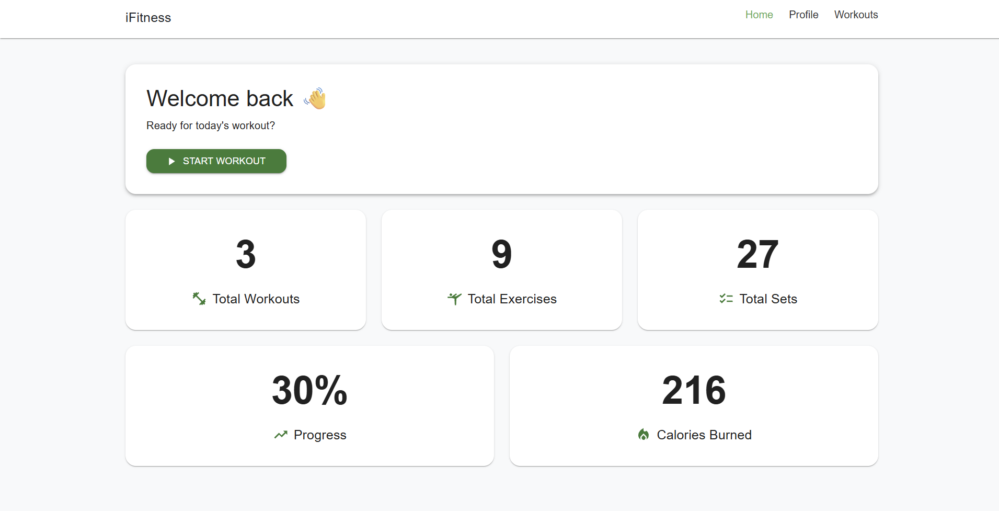
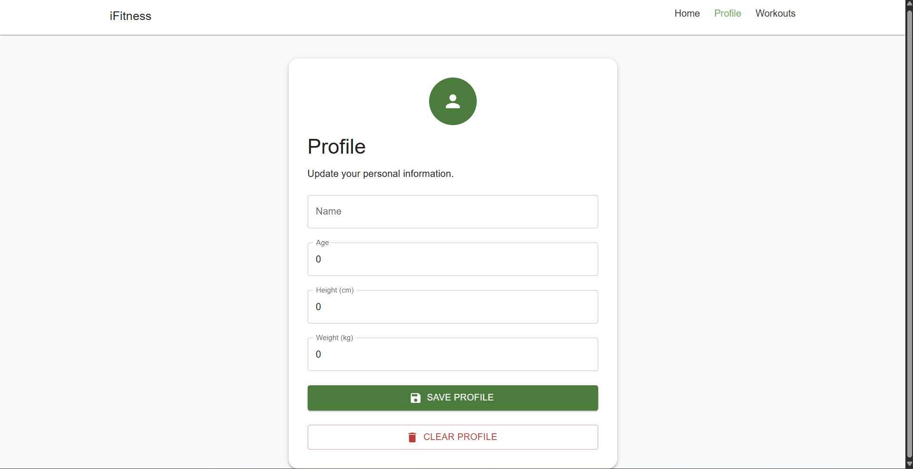
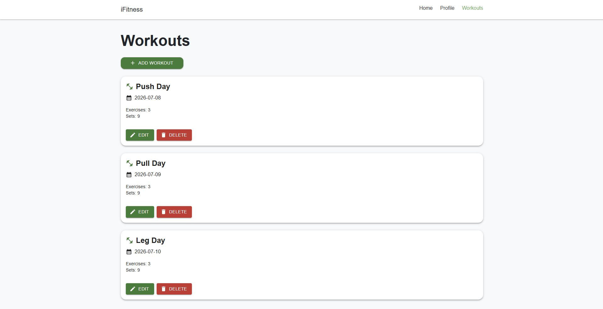
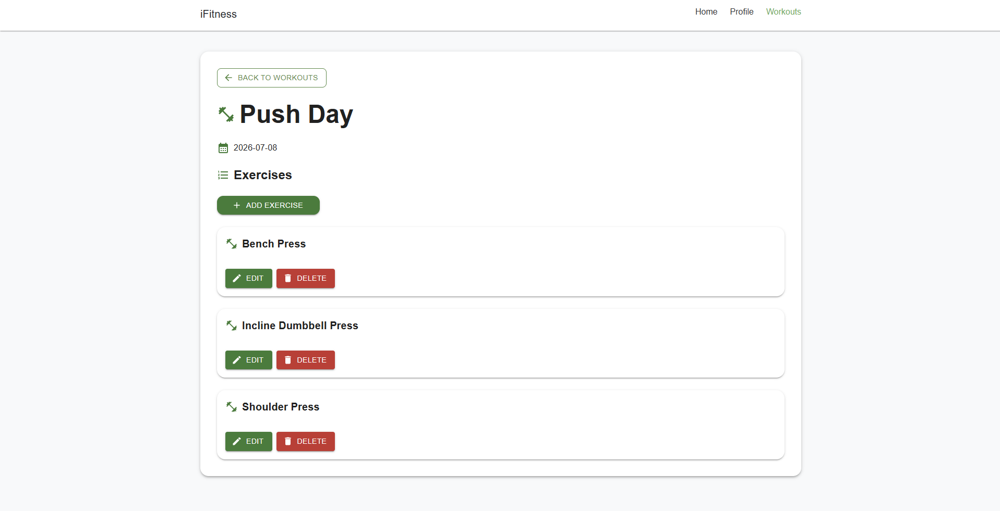
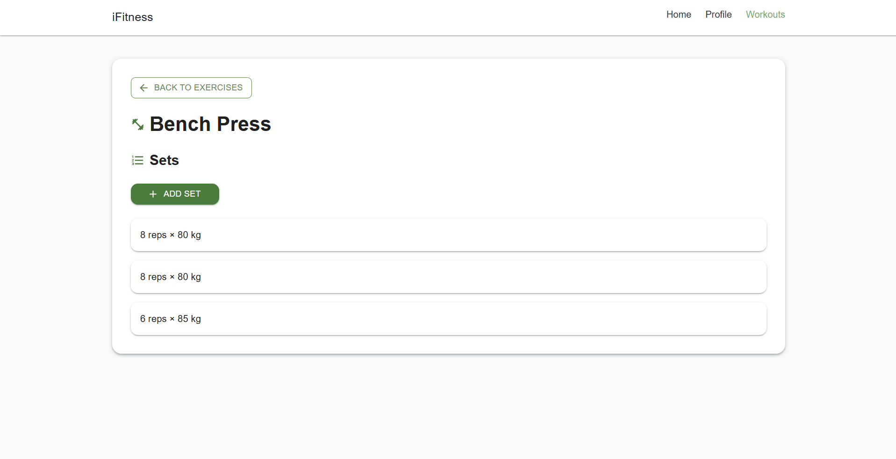
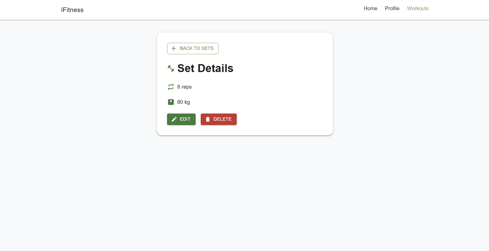

# IFitness – Fitness Tracking Application

IFitness is a fitness tracking application developed as part of my Full Stack Developer education at Intensive Code.

The project focuses on building a user-friendly application for tracking workouts and monitoring fitness progress.

## Features

- Workout tracking
- Fitness dashboard
- Workout statistics and progress overview
- Reusable UI components
- Responsive user interface

## Tech Stack

- React
- TypeScript
- Vite
- Material UI
- JavaScript
- CSS

## Getting Started

### Prerequisites

- Node.js
- npm

### Installation

1. Clone the repository:

```bash
git clone https://github.com/Kiankayan/IFitness-School-Project.git
```

2. Navigate to the project directory:

```bash
cd IFitness-School-Project
```

3. Install dependencies:

```bash
npm install
```

4. Start the development server:

```bash
npm run dev
```

## Project Information

**Project Type:** School Project

**Education:** Intensive Code – Full Stack Developer

**Status:** Completed educational project

## Screenshots

### Dashboard


### User Profile


### Workout Overview


### Workout Details


### Exercise Details


### Set Details

